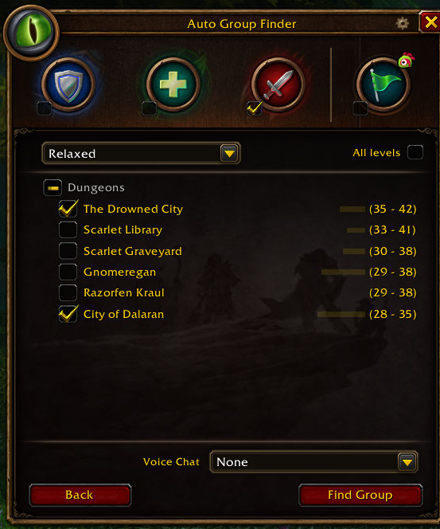
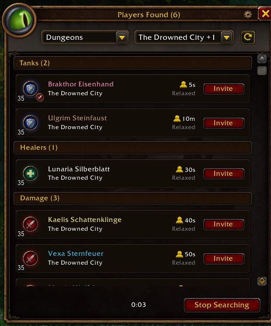
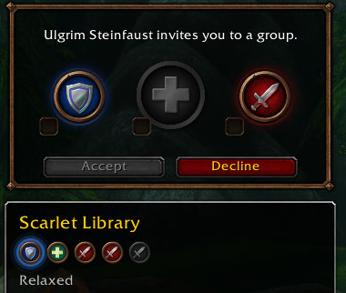
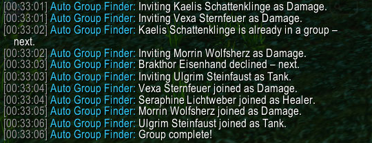

**Pick your role and dungeon, click Find Group. Auto Group Finder fills your group for you.**

Like the old meeting stones, but on top of Blizzard's group finder in WoW Forever: it lists your group, searches, and invites fitting tanks, healers and damage dealers on its own.

 

 

## What it does

- **Invites for exactly the open spots**: declines, busy and unreachable players are skipped for a while
- **Tanks and healers first**: damage dealers wait until the rare roles have joined (optional: nobody until a tank is in)
- **Players at the dungeon first**, using the zone the group finder shows for each player
- **One click at the dungeon**: stand in front of it and search for exactly that dungeon
- **Wait-time estimate** from real finished groups, optionally shared anonymously between users
- **Who invites you and why**: a card under the invite shows dungeon, group and your role
- **Your group** page: who is at the entrance, waypoint, level check, and rate players (play again / never again)
- **Keeps searching** when someone leaves right away; stays quiet after the last boss
- Minimap eye like Blizzard's, Titan Panel / ElvUI support, English, Deutsch, Français, Español, Italiano, Português, Русский

## How to use

1. `/gf` or the minimap eye opens the window.
2. Pick your role(s), the dungeons and a play style, then click **Find Group**.
3. Keep playing. When a group is full you hear a ready-check sound.

**Why does it want a click?** Blizzard only lets add-ons search right after a click or key press. While searching, your normal clicks into the game world are enough, or use the "Still here" button, the minimap eye or a key binding (Key Bindings > Auto Group Finder).

## Privacy

No server, no tracking. Settings and history stay on your computer. The only things sent are invisible add-on messages to other players: what you invite them for, and (can be turned off) wait times without names.

Bugs and ideas: [GitHub issues](https://github.com/Rasalas/wow-forever-group-finder/issues). Source code: [GitHub](https://github.com/Rasalas/wow-forever-group-finder) (MIT).
